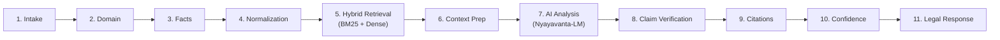

# NYAYAVANTA (न्यायवन्त)
### AI-Powered Indian Legal Information & Research Assistant

> **Core Principle**: *"Don’t make AI look magical. Make its evidence visible."*  
> **Persistent Disclaimer**: *Nyayavanta provides AI-generated legal information and research assistance based on available sources. It is not a substitute for advice from a qualified advocate or other legal professional. Users should verify important legal matters with authoritative sources and qualified professionals.*

---

## 🌟 Executive Summary

**Nyayavanta** is an India-focused legal intelligence and research assistant designed to empower citizens, litigants, law students, and advocates to understand legal issues through evidence-backed answers, authoritative statutory sources, document clause analysis, and an explicit claim verification audit trail.

Unlike generic conversational chatbots that frequently hallucinate case citations and non-existent sections, Nyayavanta connects assertions directly to the underlying Indian Bare Acts, Sections, Rules, Regulations, and binding Supreme Court decisions.

### Initial V1 Scope
1. **Consumer Complaints**: Consumer Protection Act 2019, defective goods, service deficiencies, unfair trade practices, E-Daakhil filing protocols.
2. **Rental / Tenancy Disputes**: Transfer of Property Act 1882, Model Tenancy Act, security deposit withholding, eviction notice periods.
3. **Employment Disputes**: Payment of Gratuity Act 1972, Industrial Disputes Act 1947, Section 27 Indian Contract Act (non-compete unenforceability), SAMADHAAN portal.
4. **Contract Disputes**: Indian Contract Act 1872, Sections 73 & 74 (liquidated damages and unproven penalties), MSMED Act 2006 (45-day overdue recovery).

---

## 🏛️ Architecture & Canonical 11-Step Flow

Nyayavanta implements an 11-step evidence-first execution flow:



### The 9 Canonical AI Response Sections
Every legal response is structured into 9 transparent sections:
1. **ANSWER**: Plain-language legal assessment connecting facts to law.
2. **WHY THIS MAY APPLY**: Explicit factual reasoning of applicable legal grounds.
3. **RELEVANT LAW**: Verbatim text and plain explanations of governing Bare Act sections.
4. **RELEVANT CASES**: Binding Apex Court rulings and legal holding.
5. **POSSIBLE NEXT STEPS**: Actionable steps, notice requirements, and official government portal links.
6. **IMPORTANT LIMITATIONS**: Statutory limitation periods (e.g. 2 years under CPA) and exceptions.
7. **CONFIDENCE**: Explicit AI grounding confidence score with legal caveat.
8. **VERIFICATION**: Tri-state claim grounding matrix (`VERIFIED`, `PARTIALLY_VERIFIED`, `UNVERIFIED`).
9. **SOURCES**: Direct links to primary India Code and judicial databases.

---

## 🚀 Quick Start Guide

### Prerequisites
- **Python**: 3.11+ (Python 3.14 fully supported)
- **Node.js**: v18+ (Node v24 supported) with `npm`

### 1. Backend Setup (FastAPI & Database)
```bash
# In project root
python -m pip install -r backend/requirements.txt

# Run backend API server (runs on http://localhost:8000)
python backend/run.py
```
- Swagger API Docs: `http://localhost:8000/docs`
- On startup, the backend automatically initializes the 13 database tables and seeds authoritative Indian statutes and landmark judgments.

### 2. Frontend Setup (React 19 & Vite)
```bash
# In project root
npm install

# Start Vite dev server (runs on http://localhost:3000)
npm run dev
```
- Open `http://localhost:3000` in your browser. All `/api` calls are automatically proxied to the FastAPI server on port 8000.

### 3. Run Automated Tests
```bash
# Run backend pytest suite (10/10 tests)
python -m pytest backend/tests/ -v

# Run frontend TypeScript type verification (0 errors)
npx tsc --noEmit

# Build production bundle
npm run build
```

---

## 📂 Project Structure

```
d:\Nyayanta\LawLinkSIH\
├── backend/                        # Python FastAPI Backend
│   ├── app/
│   │   ├── core/                   # Config, Security (bcrypt, JWT), Database
│   │   ├── models/                 # 13 SQLAlchemy Models
│   │   ├── schemas/                # Pydantic Schemas (Chat, Auth, Search, Docs)
│   │   ├── services/               # Hybrid Retrieval (BM25+Dense), RAG, Verification, Docs
│   │   ├── ml/                     # Nyayavanta-LM Dataset Generator, QLoRA Config, Benchmark
│   │   └── routers/                # REST Endpoints (/auth, /chat, /search, /laws, /cases, /docs)
│   ├── tests/                      # Automated PyTest Test Suites
│   ├── requirements.txt
│   └── run.py
├── src/                            # React 19 + Vite Frontend
│   ├── app/                        # React Router v7 routes
│   ├── components/
│   │   ├── layout/                 # 3-Panel DesktopShell & Mobile Drawer
│   │   └── chat/                   # EvidencePanel, AIResponseView, ClarificationCard
│   ├── pages/                      # 10 Route Views (Dashboard, Chat, Search, Cases, Docs, etc.)
│   ├── locales/                    # en.json, hi.json, mr.json Translations
│   ├── services/                   # Typed API Client
│   ├── index.css                   # Trustworthy Intelligence Design Tokens
│   └── main.tsx
├── docs/                           # 12 Capstone Delivery Artifacts
│   ├── ARCHITECTURE.md
│   ├── DATABASE_ERD.md
│   ├── API_DOCUMENTATION.md
│   ├── FRONTEND_COMPONENT_MAP.md
│   ├── RAG_PIPELINE.md
│   ├── VERIFICATION_PIPELINE.md
│   ├── TEST_REPORT.md
│   ├── ML_EVALUATION_REPORT.md
│   ├── DEPLOYMENT_GUIDE.md
│   ├── MCA_PROJECT_DOCUMENTATION.md
│   └── FINAL_DEMO_SCRIPT.md
├── package.json
├── vite.config.ts
└── README.md
```

---

## 📜 Capstone Delivery Artifacts Manifest

| Artifact | Location | Description |
| :--- | :--- | :--- |
| **Architecture Diagram** | [`docs/ARCHITECTURE.md`](file:///d:/Nyayanta/LawLinkSIH/docs/ARCHITECTURE.md) | High-level topology and 11-step execution flow diagram. |
| **Database ERD** | [`docs/DATABASE_ERD.md`](file:///d:/Nyayanta/LawLinkSIH/docs/DATABASE_ERD.md) | Entity-Relationship diagram and schema for 13 core models. |
| **API Documentation** | [`docs/API_DOCUMENTATION.md`](file:///d:/Nyayanta/LawLinkSIH/docs/API_DOCUMENTATION.md) | REST API endpoints, schemas, authentication, and examples. |
| **Component Map** | [`docs/FRONTEND_COMPONENT_MAP.md`](file:///d:/Nyayanta/LawLinkSIH/docs/FRONTEND_COMPONENT_MAP.md) | Component hierarchy, routes, and layout design. |
| **RAG Pipeline** | [`docs/RAG_PIPELINE.md`](file:///d:/Nyayanta/LawLinkSIH/docs/RAG_PIPELINE.md) | BM25 + dense semantic search and RRF reranker specification. |
| **Verification Pipeline** | [`docs/VERIFICATION_PIPELINE.md`](file:///d:/Nyayanta/LawLinkSIH/docs/VERIFICATION_PIPELINE.md) | Tri-state claim verification and citation mapping engine. |
| **Test Report** | [`docs/TEST_REPORT.md`](file:///d:/Nyayanta/LawLinkSIH/docs/TEST_REPORT.md) | Automated pytest results (10/10 passing) and tsc report. |
| **ML Evaluation Report** | [`docs/ML_EVALUATION_REPORT.md`](file:///d:/Nyayanta/LawLinkSIH/docs/ML_EVALUATION_REPORT.md) | 5-layer experiment matrix, Precision@K, and MRR metrics. |
| **Deployment Guide** | [`docs/DEPLOYMENT_GUIDE.md`](file:///d:/Nyayanta/LawLinkSIH/docs/DEPLOYMENT_GUIDE.md) | Production setup with Uvicorn, PostgreSQL, and Vite. |
| **MCA Documentation** | [`docs/MCA_PROJECT_DOCUMENTATION.md`](file:///d:/Nyayanta/LawLinkSIH/docs/MCA_PROJECT_DOCUMENTATION.md) | Full MCA capstone documentation, methodology, and results. |
| **Final Demo Script** | [`docs/FINAL_DEMO_SCRIPT.md`](file:///d:/Nyayanta/LawLinkSIH/docs/FINAL_DEMO_SCRIPT.md) | Step-by-step viva presentation walkthrough script. |

---

## ⚖️ License
Released under the Apache 2.0 License. Developed for Indian legal tech research and educational assistance.
