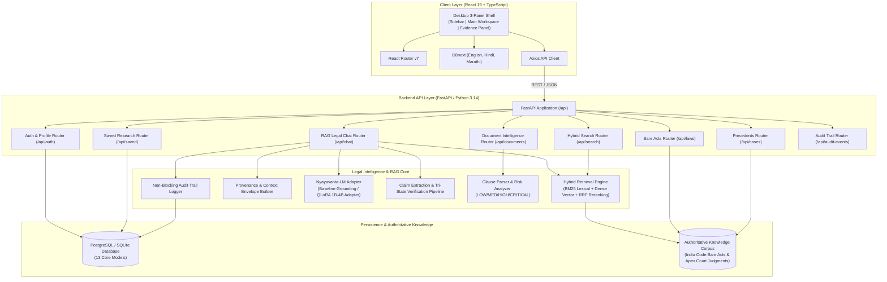

# Nyayavanta: System Architecture Document

> **Product Positioning**: AI-Powered Indian Legal Information & Research Assistant  
> **Core Principle**: *"Don’t make AI look magical. Make its evidence visible."*  
> **Version**: 1.0.0 (V1 Scope: Consumer Complaints, Rental/Tenancy Disputes, Employment Disputes, Contract Disputes)

---

## 1. High-Level System Architecture

Nyayavanta connects Indian citizens, advocates, and researchers to verifiable primary legal sources through an 11-step canonical execution flow:

---

## 2. Canonical 11-Step Execution Flow

1. **User Intake**: User registers/logs in, specifies legal dispute facts or query, uploads contractual PDF/images.
2. **Domain Selection**: Automatically classified or user-selected from four V1 domains: *Consumer Complaints*, *Rental / Tenancy Disputes*, *Employment Disputes*, *Contract Disputes*.
3. **Fact & Document Intake**: Structured extraction of financial quantum, incident dates, opposing parties, written lease/employment agreements.
4. **Pre-processing & Normalization**: Legal token cleaning, preserve section syntax (e.g. `Section 2(7)`, `Section 108(B)(q)`), metadata tagging, and chunking.
5. **Hybrid Retrieval Layer**: Union of BM25 lexical retriever and dense semantic vector search, scored via Reciprocal Rank Fusion (RRF).
6. **Context Preparation**: Top-K retrieved passages + case facts formatted with strict provenance tracking (Chunk ID, Act name, section number, source URL).
7. **AI Analysis**: Domain-specialized Nyayavanta-LM adapter formulating grounded legal reasoning across the 9 canonical response sections.
8. **Claim Verification**: Automatic decomposition into discrete factual and statutory claims, verified as `SUPPORTED`, `CONTRADICTED`, or `NOT_ENOUGH_EVIDENCE`.
9. **Citation Matching & Source Mapping**: Every legal assertion maps to primary Bare Act sections or landmark Supreme Court citations.
10. **Confidence & Uncertainty Scoring**: Transparent calculation of AI confidence score with explicit legal caveats (not a guarantee of outcome).
11. **Evidence-Backed Legal Response**: Rendered in the UI with Case Summary, Relevant Law, Relevant Cases, Next Steps, Limitations, Confidence, Verification, and Sources.

---

## 3. Cross-Cutting Architectural Principles

- **Zero-Hallucination Policy**: Citations, section numbers, case names, and URLs must originate from the authoritative corpus. If an authority cannot be verified, it is marked as `UNVERIFIED`.
- **Persistent Legal Disclaimer**: Rendered on all headers, reports, and chat views. Nyayavanta provides informational assistance, never formal advocate representation.
- **Tenant & Document Isolation**: User uploaded files and research history are isolated per user account.
