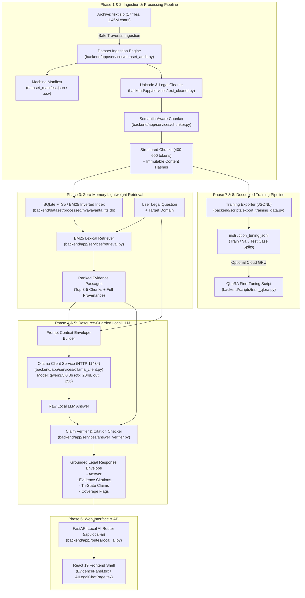

# Nyayavanta Local AI Architecture Specification

> **Host Target**: Windows 11 / CPU-only / <= 8 GB RAM (1.4 GB free physical memory)  
> **Core Pipeline**: Local SQLite FTS5 / BM25 Inverted Index + Ollama Local LLM (`qwen3.5:0.8b`)  
> **Guiding Principle**: *"Don't make AI look magical. Make its evidence visible."*

---

## 1. System Topology & Component Diagram

---

## 2. Resource Budget & Memory Architecture

On a Windows PC with **8 GB total RAM** and approximately **1.4 GB free physical memory**, high-footprint deep learning frameworks (Torch/CUDA vector embeddings, in-memory FAISS indices, or multi-billion parameter models) will trigger severe swapping, page faults, or Out-Of-Memory (OOM) crashes.

| Component | Architecture Decision | Memory Impact | Rationale |
| :--- | :--- | :--- | :--- |
| **Document Storage** | SQLite FTS5 database on disk | < 25 MB RAM | Disk-backed inverted index; only relevant rows read into memory. |
| **Token Processing** | Streaming generator chunking | < 50 MB RAM | Files processed one by one; garbage-collected immediately. |
| **Vector Embeddings** | BM25 Lexical first; Dense Vector optional | 0 MB for BM25 | Pure algorithmic TF-IDF/BM25 requires no Torch model in memory. |
| **Local LLM Engine** | Ollama running `qwen3.5:0.8b` | ~700 MB – 1.0 GB RAM | 0.8B quantized parameters comfortably fit in 1.4 GB available RAM. |
| **Context Window** | Bounded to 2048 tokens; Output: 256 tokens | Minimal RAM | Prevents KV-cache explosion during CPU generation. |
| **Total Peak Budget** | **Strictly <= 1.2 GB RAM** | Safe headroom | Leaves operating system and browser fully functional. |

---

## 3. Strict Citations & Zero-Hallucination Policy

1. **No Phantom Authorities**: The model's prompt envelope explicitly orders:
   > *"You are an objective legal research assistant. Use ONLY the supplied legal passages. Never invent section numbers, court orders, case names, or statutory obligations. If the provided excerpts do not mention an answer, respond with 'NOT_ENOUGH_EVIDENCE'."*
2. **Deterministic Source Cross-Matching**:
   - `answer_verifier.py` parses all statutory or case citations in the answer.
   - Each citation is validated against the exact retrieved chunks in the context envelope.
   - If a citation does not exist in the retrieved passages, it is flagged as `UNVERIFIED_INVENTION` in the verification payload.
3. **Domain Coverage Gate**:
   - If a user queries `employment` or `contract` domains where the archive currently has 0 files, the pipeline skips inference and immediately returns `COVERAGE_GAP`, directing the user to official government portals.
