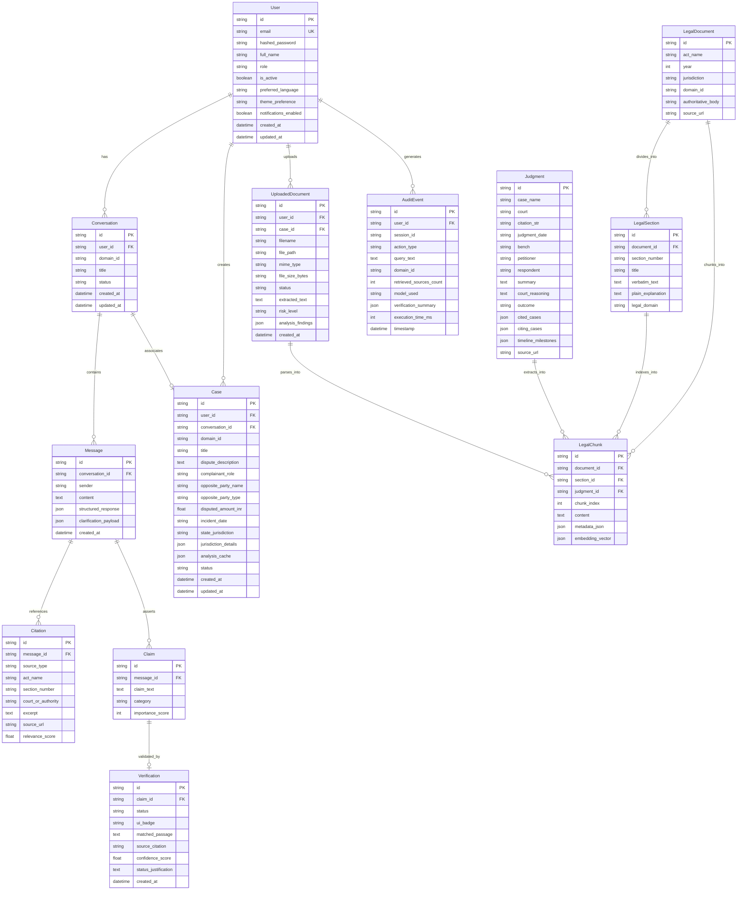

# Nyayavanta: Database Entity-Relationship Diagram (ERD)

> **ORM**: SQLAlchemy 2.0  
> **Supported Engines**: PostgreSQL (Production) / SQLite (Local Zero-Config Dev & Automated CI)  
> **Total Core Models**: 13

---

## 1. Mermaid Entity-Relationship Diagram

---

## 2. Model Dictionary & Relationships

1. **User**: Authentication, role permissions (advocate, researcher, citizen), and user preferences.
2. **Conversation**: Multi-turn legal inquiry sessions grouped chronologically.
3. **Message**: Individual exchanges containing user query or 9-section evidence-backed AI response.
4. **Case**: Structured legal matter record with pecuniary jurisdiction and parties.
5. **LegalDocument**: Indian Bare Acts (e.g. CPA 2019, TPA 1882, ICA 1872).
6. **LegalSection**: Specific statutory sections with verbatim text and plain English explanations.
7. **Judgment**: Binding precedent records from Supreme Court of India and High Courts.
8. **LegalChunk**: Atomic normalized passages indexed by BM25 and vector retriever.
9. **Claim**: Discrete factual or statutory assertions extracted from AI answers.
10. **Verification**: Tri-state grounding verdict (`SUPPORTED`, `CONTRADICTED`, `NOT_ENOUGH_EVIDENCE`) and UI status badge.
11. **Citation**: Explicit links connecting AI statements to source passages and URLs.
12. **UploadedDocument**: User-uploaded agreements, lease deeds, or invoices with parsed clauses and risk rating.
13. **AuditEvent**: Transparent log of user queries, retrieved sources, execution latency, and verification passes.
