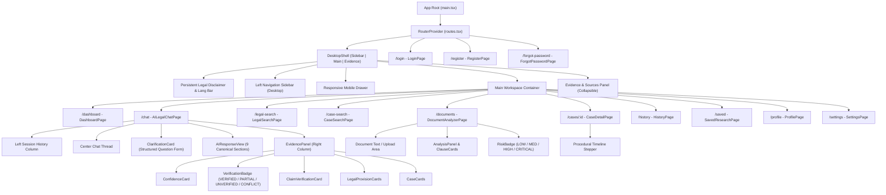

# Nyayavanta: Frontend Component Map

> **Architecture**: React 19 + TypeScript + Vite + Tailwind CSS v4 + React Router v7 + Lucide React  
> **Layout Direction**: "Trustworthy Intelligence" 3-Panel Desktop Shell with Mobile Drawer

---

## 1. Component Hierarchy

---

## 2. Page & Route Manifest

| Route | Page Component | Key Functionality |
| :--- | :--- | :--- |
| `/dashboard` | `DashboardPage` | Hero search, 4 V1 domain cards, quick actions, recent research & docs. |
| `/chat` | `AILegalChatPage` | 3-panel research workspace, live RAG generation, clarification prompt, evidence panel. |
| `/legal-search` | `LegalSearchPage` | Multi-tab search (All, Acts, Sections, Regulations, Judgments), domain filters. |
| `/case-search` | `CaseSearchPage` | Supreme Court and High Court landmark cases filterable by court & holding. |
| `/cases/:id` | `CaseDetailPage` | Ratio decidendi, case facts, procedural timeline (`Filing -> Hearing -> Interim -> Judgment -> Final`). |
| `/documents` | `DocumentAnalyzerPage` | Document text ingestion, clause enforceability checker, risk assessment. |
| `/history` | `HistoryPage` | Chronological research history grouped by Today, Yesterday, 7 Days, Older. |
| `/saved` | `SavedResearchPage` | Bookmarked provisions and cases with filter tabs and export options. |
| `/profile` | `ProfilePage` | User role, credentials, and verification status. |
| `/settings` | `SettingsPage` | Appearance (Light/Dark/System), Language (EN/HI/MR), Notifications, Privacy. |
| `/login` | `LoginPage` | JWT authentication and session initiation. |
| `/register` | `RegisterPage` | Citizen and Advocate onboarding. |
