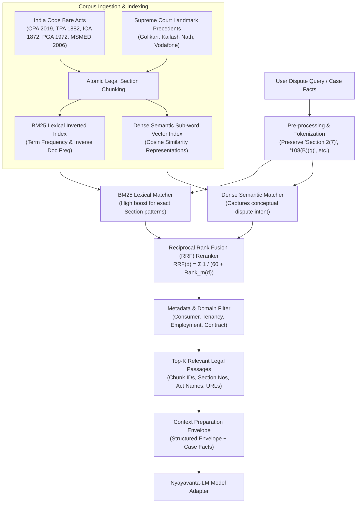

# Nyayavanta: RAG Retrieval & Ingestion Pipeline

> **Core Objective**: Ground AI responses in authentic, verifiable Indian primary legal materials with chunk-level provenance.

---

## 1. Pipeline Architecture

---

## 2. Ingestion & Indexing Specifications

### Chunking Strategy
- **Bare Acts**: Each chunk represents a discrete statutory section (`LegalSection`), preserving:
  - Act name and publication year
  - Section number (e.g. `Section 2(7)`, `Section 74`)
  - Section title
  - Verbatim legislative text
  - Plain English explanation
  - Canonical official URL (India Code repository)
- **Judicial Precedents**: Each landmark case is indexed with:
  - Case title and citation string
  - Bench composition and court level
  - Summary of facts
  - Court reasoning (Ratio Decidendi)
  - Operative outcome and disposition

### Hybrid Fusion Formula
Reciprocal Rank Fusion (RRF) combines lexical BM25 rankings and dense semantic rankings without requiring sensitive hyperparameter tuning:
$$\text{RRF Score}(d) = \sum_{m \in \{\text{BM25}, \text{Dense}\}} \frac{1}{60 + \text{Rank}_m(d)}$$
Exact section keyword matches receive an additional $2.5\times$ boost in the lexical index, ensuring direct hits when a user mentions specific section numbers.
